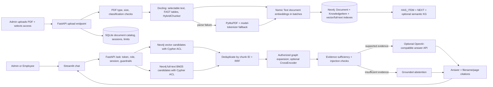

# Enterprise Graph RAG demo

An extension of the existing Streamlit + FastAPI chatbot. It ingests multiple PDFs, parses structured content with Docling HybridChunker, stores role-scoped chunks and vectors in Neo4j, and retrieves with a hybrid Neo4j vector + Lucene BM25 path fused by reciprocal rank fusion. SQLite stores application sessions and a synchronized document catalog. The app remains one Streamlit frontend and one FastAPI backend.

## Architecture and runtime flow



1. Admin uploads PDFs through Streamlit. The backend checks file type, header, size, and the selected `Public` or `Admin-only` classification. The default is `Admin-only`.
2. Docling parses the PDF. HybridChunker keeps heading context, page provenance, and table headers. The existing manifest remains useful for initial sample-folder documents, but user uploads do not need a manifest row.
3. Text/table chunks are embedded with Nomic Embed Text v1.5 using `search_document:`. Query embeddings use `search_query:`. Neo4j stores a stable document ID, unique chunk IDs, policy roles, page/type, content, and embeddings. Picture, OCR, page-image, and formula processing are disabled by default for speed and can be enabled in configuration.
4. Neo4j vector candidates and its Lucene full-text BM25 candidates are each role-filtered before passage text returns. The app combines rankings with RRF using `1 / (60 + rank)`, deduplicates by the shared chunk ID, optionally reranks only authorized candidates, then follows bounded graph links.
5. The evidence gate and prompt-injection checks run before answer generation. The LLM receives only authorized evidence and prior user questions for reference resolution; previous assistant answers are excluded so old answers cannot bypass a changed ACL. The response cites the source filename and PDF page, or abstains.

The current retrieval controller is a small bounded Python loop, not LangGraph. A future optional LangGraph implementation can express Question Analysis -> Retrieval -> Evidence Validation -> Conditional Retry -> Answer Generation -> Final Response. It is intentionally not a runtime dependency for the Stage 1 demo.

## Access policies and document replacement

- `Public`: Admin and Employee may list and retrieve the document.
- `Admin-only`: Admin may list and retrieve the document; Employee receives no content.
- Admin can access either policy. Existing HR authentication is retained only for backward compatibility; new policy assignments use Admin and Employee.
- Every new document receives an automatically generated ID. Re-upload by the same filename replaces its graph nodes, relationships, full-text/vector index entries, BM25-indexed content, SQLite metadata, and stale extracted image assets without duplicating chunks.
- Admin uploads are stored under ignored `data/documents/`. The seeded sample-folder import reads `data/sample_docs/*.pdf` and uses manifest policy as its seed default; unknown PDFs imported from that folder default to Admin-only.
- Only Admin may call either ingestion endpoint. Backend checks remain authoritative even if the UI is bypassed.

## Setup (Windows / PowerShell)

Requirements: Python 3.10/3.11, 8 GB RAM minimum (16 GB preferred), several GB free for model caches, and a reachable Neo4j AuraDB instance. Docker is not required.

```powershell
cd D:\Users\DELL\Documents\enterprise-rag-demo
python -m venv .venv
New-Item -ItemType Directory -Force data\tmp,data\pip-cache,data\model_cache | Out-Null
$env:TEMP=(Resolve-Path data\tmp).Path
$env:TMP=$env:TEMP
$env:PIP_CACHE_DIR=(Resolve-Path data\pip-cache).Path
$env:HF_HOME=(Resolve-Path data\model_cache).Path
.\.venv\Scripts\python.exe -m pip install -r requirements.txt
```

Copy `.env.example` to `.env` if you do not already have a local `.env`. Set `NEO4J_URI`, `NEO4J_USER`, `NEO4J_PASSWORD` and a long random `TOKEN_SECRET`. Set `DEMO_PASSWORD` to the shared demo password you want. To generate prose instead of a retrieval excerpt, configure an approved OpenAI-compatible `LLM_BASE_URL`, `LLM_API_KEY` and `LLM_MODEL`. Never commit `.env` or uploaded customer documents.

## Run the application

Open two PowerShell terminals in the project directory.

Terminal 1 - API:

```powershell
.\.venv\Scripts\python.exe -m uvicorn app.api:app --host 127.0.0.1 --port 8000
```

Terminal 2 - Streamlit:

```powershell
.\.venv\Scripts\python.exe -m streamlit run app/ui.py
```

Open the local URL printed by Streamlit (usually `http://localhost:8501`). Sign in as `admin` to upload PDFs and choose access, or sign in as `employee` to query Public documents. Initial demo credentials come from `DEMO_PASSWORD` in `.env` (the code fallback is `RagDemo!2026`). To index the seeded sample, use the Admin sidebar action **Import sample_docs folder**. New uploads can be indexed at any time with **Upload multiple PDFs**.

Ingestion result rows report indexed/failed status, document ID, classification, pages, chunk/table/image counts, parser path, and errors. When optional picture extraction is enabled, pictures use Nomic Vision embeddings; otherwise text/table retrieval remains the fast default.

## Performance and optional parsing

The default setup favors a quick first pass:

| Setting | Default | Purpose |
|---|---:|---|
| `CHUNK_MAX_TOKENS` | `512` | HybridChunker token ceiling for the configured Nomic tokenizer. |
| `EMBEDDING_BATCH_SIZE` | `32` | Text embedding batch size. |
| `RETRIEVAL_CANDIDATE_K` | `30` | Candidates from each Neo4j retrieval path before fusion. |
| `MAX_UPLOAD_MB` | `25` | Upload size limit. |
| `CROSS_ENCODER_ENABLED` | `false` | Load the CrossEncoder only when enabled. |
| `DOCLING_ENABLE_OCR` | `false` | Enable OCR for scanned PDFs when needed. |
| `DOCLING_ENABLE_FORMULA_ENRICHMENT` | `false` | Optional Docling formula enrichment. |
| `DOCLING_GENERATE_PAGE_IMAGES` | `false` | Optional full-page image generation. |
| `DOCLING_EXTRACT_PICTURES` | `false` | Optional picture crops and Nomic Vision embeddings. |

Docling table recognition is always enabled in FAST mode. PyMuPDF remains the text-only fallback. CrossEncoder uses `CROSS_ENCODER_MODEL` (default `cross-encoder/ms-marco-MiniLM-L-6-v2`) and only reranks evidence that already passed Neo4j ACL filtering. Model instances are cached in process; downloads are not repeated after they are available in `data/model_cache`.

## Evaluation and tests

Run isolated automated tests (they mock Neo4j/model/API responses and do not need paid API calls):

```powershell
.\.venv\Scripts\python.exe -m pytest -q
```

Run the deterministic smoke/evidence evaluation against a running API after indexing the sample PDF:

```powershell
.\.venv\Scripts\python.exe evaluate_demo.py
```

Ragas answer faithfulness and retrieval-context recall are a separate, optional LLM-as-judge evaluation. Install the extra dependencies only for that step, configure the approved LLM endpoint, start the backend, and run:

```powershell
.\.venv\Scripts\python.exe -m pip install -r requirements-eval.txt
.\.venv\Scripts\python.exe evaluate_ragas.py
```

Ragas evaluation sends the sample questions, generated answers, and authorized retrieved excerpts to the configured judge endpoint. Its output is saved to `outputs/ragas_evaluation.json`.

## Current limits

- Neo4j is required for live ingestion and retrieval. Automated tests use mocks and do not establish real AuraDB availability or production ACL isolation.
- The current paper/evaluation set is a small demo corpus; quality numbers are not general benchmarks.
- Formula enrichment, OCR, page images, and picture extraction are off by default. Formula extraction accuracy requires separate validation.
- PII detection reports regex matches; it does not redact them. Prompt-injection checks are pattern-based demo guardrails.
- Ingestion runs synchronously. SQLite session and rate-limit state is intended for a single host; multi-replica deployment needs shared state.
- This demo uses local shared-password identities. Add SSO, managed secrets, audit/retention, malware scanning, OCR quality evaluation, durable ingestion workers, and monitoring before production use.
