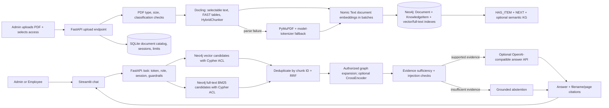

# Enterprise Graph RAG demo

A multimodal Agentic RAG demo for the research paper **Attention Is All You Need**. It ingests PDFs with Docling, separates text, tables, formulas and figures, preserves item-level page/section/provenance metadata, and indexes text and figure vectors in Neo4j. A bounded query planner routes each question to the requested content types; Neo4j vector search + Lucene BM25 + RRF + graph expansion gather the evidence. SQLite stores sessions and the document catalog. The app remains one Streamlit frontend and one FastAPI backend.

## Architecture and runtime flow



1. Admin uploads PDFs through Streamlit. The backend checks file type, header, size, and the selected `Public` or `Admin-only` classification. The default is `Admin-only`.
2. Docling parses the PDF. HybridChunker keeps heading context, page provenance, and table headers. The existing manifest remains useful for initial sample-folder documents, but user uploads do not need a manifest row.
3. Text, table and formula records use Nomic Embed Text v1.5; extracted figures use Nomic Embed Vision v1.5. These v1.5 encoders share a 768-dimensional space, so natural-language queries can retrieve figure vectors from the same Neo4j vector index. Text/table/formula/metadata artifacts are persisted under `data/extracted/`; figure crops remain under `data/assets/`. Every item retains its type, page, section, caption, Docling reference, bounding box/provenance and file path. Picture extraction is enabled by default; Gemini descriptions require `GEMINI_API_KEY`. Formula enrichment and OCR remain opt-in.
4. The query planner creates up to four modality-specific retrieval tasks for text, tables, figures and formulas. Each task uses role-filtered Neo4j vector + Lucene BM25, RRF and authorized graph expansion. Figure vectors are searchable through the shared Nomic text/vision embedding space. Typed `Section` and `KnowledgeItem` nodes are linked by `HAS_SECTION`, `HAS_CONTENT`, `CONTAINS_*`, `NEXT` and source-grounded `RELATED_ON_PAGE` relationships.
5. The evidence gate and prompt-injection checks run before answer generation. The LLM receives only authorized evidence and prior user questions for reference resolution; previous assistant answers are excluded so old answers cannot bypass a changed ACL. The response cites the source filename and PDF page, or abstains.

The current controller is a bounded Python query planner, not LangGraph. When the configured LLM is available, it returns a structured JSON retrieval plan; otherwise deterministic keyword rules route the request. LangGraph is not required for this implementation.

## Access policies and document replacement

- `Public`: Admin and Employee may list and retrieve the document.
- `Admin-only`: Admin may list and retrieve the document; Employee receives no content.
- Admin can access either policy. Existing HR authentication is retained only for backward compatibility; new policy assignments use Admin and Employee.
- Every new document receives an automatically generated ID. Re-upload by the same filename replaces its graph nodes, relationships, full-text/vector index entries, BM25-indexed content, SQLite metadata, and stale extracted image assets without duplicating chunks.
- Admin uploads are stored under ignored `data/documents/`. The seeded sample-folder import reads `data/sample_docs/*.pdf` and uses manifest policy as its seed default; unknown PDFs imported from that folder default to Admin-only.
- Only Admin may call either ingestion endpoint. Backend checks remain authoritative even if the UI is bypassed.

## Setup (Windows / PowerShell)

Requirements: Python 3.10/3.11, 8 GB RAM minimum (16 GB preferred), several GB free for model caches, and a reachable Neo4j AuraDB instance. Docker is not required.

```powershell
cd D:\Users\DELL\Documents\enterprise-rag-demo
python -m venv .venv
New-Item -ItemType Directory -Force data\tmp,data\pip-cache,data\model_cache | Out-Null
$env:TEMP=(Resolve-Path data\tmp).Path
$env:TMP=$env:TEMP
$env:PIP_CACHE_DIR=(Resolve-Path data\pip-cache).Path
$env:HF_HOME=(Resolve-Path data\model_cache).Path
.\.venv\Scripts\python.exe -m pip install -r requirements.txt
```

Copy `.env.example` to `.env` if you do not already have a local `.env`. Set `NEO4J_URI`, `NEO4J_USER`, `NEO4J_PASSWORD` and a long random `TOKEN_SECRET`. Set `DEMO_PASSWORD` to the shared demo password you want. To generate prose instead of a retrieval excerpt, configure an approved OpenAI-compatible `LLM_BASE_URL`, `LLM_API_KEY` and `LLM_MODEL`. Never commit `.env` or uploaded customer documents.

## Run the application

Open two PowerShell terminals in the project directory.

Terminal 1 - API:

```powershell
.\.venv\Scripts\python.exe -m uvicorn app.api:app --host 127.0.0.1 --port 8000
```

Terminal 2 - Streamlit:

```powershell
.\.venv\Scripts\python.exe -m streamlit run app/ui.py
```

Open the local URL printed by Streamlit (usually `http://localhost:8501`). Sign in as `admin` to upload PDFs and choose access, or sign in as `employee` to query Public documents. Initial demo credentials come from `DEMO_PASSWORD` in `.env` (the code fallback is `RagDemo!2026`). To index the seeded sample, use the Admin sidebar action **Import sample_docs folder**. New uploads can be indexed at any time with **Upload multiple PDFs**.

Ingestion result rows report indexed/failed status, document ID, classification, pages, counts by content type, artifact locations, parser path and warnings. Figure crops use Nomic Vision embeddings; Gemini adds a searchable visual description when configured, otherwise the extracted caption is used.

## Performance and optional parsing

The default setup favors a quick first pass:

| Setting | Default | Purpose |
|---|---:|---|
| `CHUNK_MAX_TOKENS` | `512` | HybridChunker token ceiling for the configured Nomic tokenizer. |
| `EMBEDDING_BATCH_SIZE` | `32` | Text embedding batch size. |
| `RETRIEVAL_CANDIDATE_K` | `30` | Candidates from each Neo4j retrieval path before fusion. |
| `MAX_UPLOAD_MB` | `25` | Upload size limit. |
| `CROSS_ENCODER_ENABLED` | `false` | Load the CrossEncoder only when enabled. |
| `DOCLING_ENABLE_OCR` | `false` | Enable OCR for scanned PDFs when needed. |
| `DOCLING_ENABLE_FORMULA_ENRICHMENT` | `false` | Optional Docling formula enrichment. |
| `DOCLING_GENERATE_PAGE_IMAGES` | `false` | Optional full-page image generation. |
| `DOCLING_EXTRACT_PICTURES` | `true` | Extract figure crops and create Nomic Vision embeddings. |

Docling table recognition is always enabled in FAST mode. Formula enrichment is opt-in with `DOCLING_ENABLE_FORMULA_ENRICHMENT=true`; the setting invokes Docling's extra formula model and should be validated on the target paper. `GEMINI_API_KEY` enables Gemini figure descriptions, while the caption-only fallback works without it. `AGENT_PLANNER_ENABLED=true` enables an LLM-backed JSON planner when the OpenAI-compatible endpoint is configured; otherwise the heuristic planner is used. PyMuPDF remains the text-only fallback. CrossEncoder only reranks evidence that already passed Neo4j ACL filtering. Models are cached in process and in `data/model_cache`.

## Evaluation and tests

Run isolated automated tests (they mock Neo4j/model/API responses and do not need paid API calls):

```powershell
.\.venv\Scripts\python.exe -m pytest -q
```

Run the deterministic smoke/evidence evaluation against a running API after indexing the sample PDF:

```powershell
.\.venv\Scripts\python.exe evaluate_demo.py
```

Ragas answer faithfulness and retrieval-context recall are a separate, optional LLM-as-judge evaluation. Install the extra dependencies only for that step, configure the approved LLM endpoint, start the backend, and run:

```powershell
.\.venv\Scripts\python.exe -m pip install -r requirements-eval.txt
.\.venv\Scripts\python.exe evaluate_ragas.py
```

Ragas evaluation sends the sample questions, generated answers, and authorized retrieved excerpts to the configured judge endpoint. Its output is saved to `outputs/ragas_evaluation.json`.

## Current limits

- Neo4j is required for live ingestion and retrieval. Automated tests use mocks and do not establish real AuraDB availability or production ACL isolation.
- The current paper/evaluation set is a small demo corpus; quality numbers are not general benchmarks.
- Formula enrichment and OCR are opt-in. Figure crops are enabled by default; Gemini descriptions are optional and fall back to the source caption. Validate formula and figure extraction against the target PDF before relying on them.
- PII detection reports regex matches; it does not redact them. Prompt-injection checks are pattern-based demo guardrails.
- Ingestion runs synchronously. SQLite session and rate-limit state is intended for a single host; multi-replica deployment needs shared state.
- This demo uses local shared-password identities. Add SSO, managed secrets, audit/retention, malware scanning, OCR quality evaluation, durable ingestion workers, and monitoring before production use.
