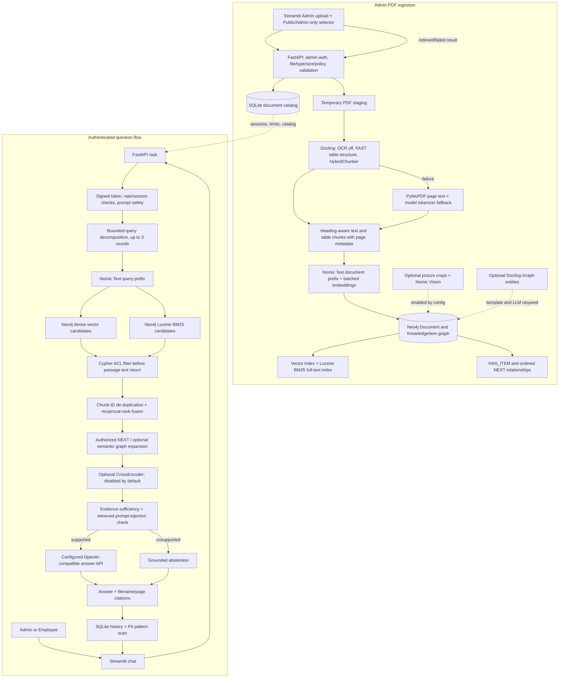

# Enterprise Graph RAG architecture

## Implemented architecture

## Responsibilities and access boundaries

- `app/ui.py`: retained Streamlit UI for Admin/Employee sign-in, PDF upload, access selection, chat, document list, citations, and flow trace.
- `app/api.py`: retained FastAPI API. It validates Admin upload authorization and PDF metadata, keeps temporary uploads until successful indexing, validates sessions/rate limits, invokes retrieval, and serializes citations.
- `app/rag.py`: Docling options, HybridChunker, PyMuPDF fallback, cached Nomic embedding models, replacement-safe Neo4j writes, vector retrieval, BM25 full-text retrieval, RRF, optional CrossEncoder, and bounded graph expansion.
- `app/storage.py`: SQLite document catalog, session state, turn history, and rate-limit counters.
- `app/generation.py`: optional OpenAI-compatible grounded answer generation. Only authorized passages and prior user questions are sent; assistant history is excluded.
- `app/config.py`: environment-backed upload, chunk, retrieval, model and parser options.

Neo4j owns the single dense-vector index and the full-text index. The backend detects the Aura server version and uses Cypher 25 `SEARCH` for vector search on Neo4j 2026.01+, and `SEARCH` for full-text BM25 on Neo4j 2026.09+; earlier compatible servers use the existing query procedures. Neo4j full-text search uses Lucene BM25 scoring and returns original chunk IDs and metadata alongside authorized candidate text. RRF deduplicates by the same `chunk_id` across both retrieval lists and scores each 1-based rank as `1 / (60 + rank)`. No second dense index (such as FAISS) is maintained.

## Access policy

- Public role list is exactly `Admin` and `Employee`.
- Admin-only role list is exactly `Admin`.
- Admin can retrieve both classes. Employee can retrieve only Public content.
- Upload classification is checked in FastAPI and stored in both Neo4j and SQLite. Cypher filters each candidate before passage text is returned. The image asset endpoint independently verifies role access.
- A document's existing ID persists across re-uploads. A new uploaded filename gets a UUID. The graph replacement transaction removes previous document/chunk/entity nodes and relationships; the full-text and vector indexes update from the replaced nodes. Old picture assets are removed after successful graph replacement.

## Parsing and performance defaults

Installed compatibility was checked against Docling 2.145.0 and Docling Core 2.105.0. This version supports `docling.chunking.HybridChunker`, `HuggingFaceTokenizer`, `PdfPipelineOptions.do_table_structure`, and `TableFormerMode.FAST`.

- OCR, formula enrichment, page-image generation, and picture extraction default off.
- Table structure recognition is enabled in FAST mode.
- HybridChunker uses the Nomic tokenizer with configurable `CHUNK_MAX_TOKENS` and repeats table headers.
- PyMuPDF is retained as a fallback. Its page text is split by the same model tokenizer.
- Text embeddings are batched; text/vision/Chunker models are cached in process and use `data/model_cache`.
- CrossEncoder is disabled by default and only receives candidates already ACL-filtered by Neo4j.

## Bounded controller and optional future workflow

The current implemented controller in `agentic_search()` is deterministic Python: it decomposes simple multi-part questions, issues no more than three retrieval rounds, deduplicates results, and uses an evidence overlap check. It is not LangGraph.

An optional future LangGraph flow can use these nodes: **Question Analysis -> Retrieval -> Evidence Validation -> Conditional Retrieval Retry -> Answer Generation -> Final Response**. It should be added only after Stage 1 retrieval tests are stable; no LangGraph dependency is required by the current application.

## Evaluation

- `pytest` tests upload authorization, automatic document registration, replace-without-duplicate behavior, Public/Admin-only access, mocked vector and BM25 retrieval, RRF math, CrossEncoder ordering, citations, abstention, prompt injection, and bounded retrieval.
- `evaluate_demo.py` runs the sample question set against the live API and checks expected evidence and page hints.
- `evaluate_ragas.py` is separate and optional; it uses Ragas faithfulness and context-recall metrics with the configured approved LLM endpoint and saves its report under `outputs/`.
- Mocked automated tests do not establish live AuraDB, real model quality, PDF parser quality, or end-to-end ACL isolation. Run the live demo checks with a connected AuraDB before making those claims.
